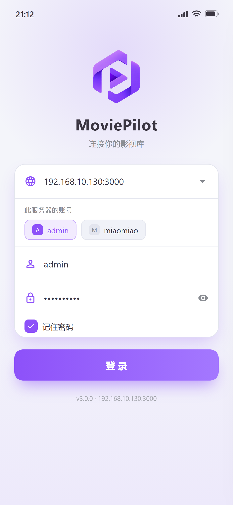
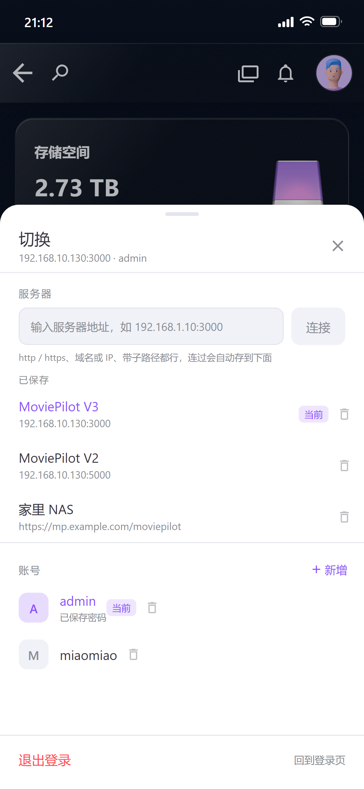
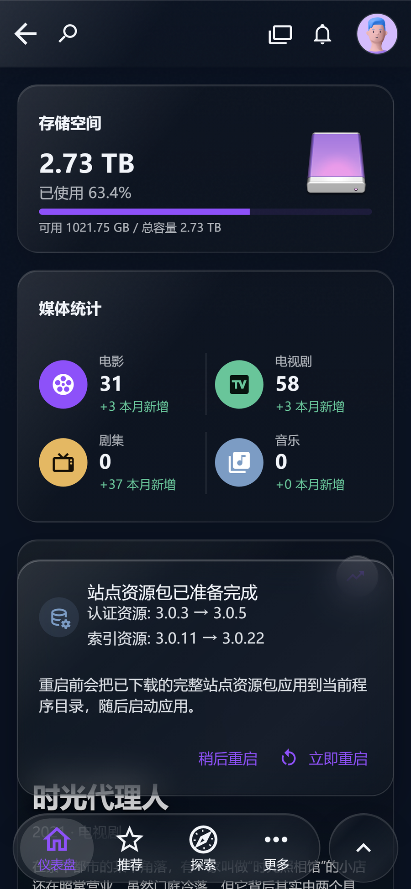

<p align="center">
  
</p>

<h1 align="center">MoviePilot Android</h1>

<p align="center">
  给 MoviePilot 套一个安卓外壳：登录一次，之后随时切换服务器和账号。<br>
  <sub>界面就是你的 MoviePilot 网页版，客户端不重复实现任何业务页面。</sub>
</p>

<p align="center">
  <a href="https://github.com/mmaotv/MoviePilot-Mobile/releases/latest"></a>
  
  
  
  <a href="LICENSE"></a>
</p>

<br>

## ⬇️ 下载安装

**[点这里下载最新版 APK](https://github.com/mmaotv/MoviePilot-Mobile/releases/latest)** ｜ [更新日志](CHANGELOG.md)

安装完打开，填上你自己的 MoviePilot 地址即可使用。**本 App 不含服务端**，需要你先跑着一个 MoviePilot（V2 / V3 都支持，NAS 上的 Docker 装好即可）。

<br>

## 这是什么东西

MoviePilot 的网页版在手机浏览器里用着别扭：地址要重新输、切换服务器要重登、状态栏还老是被压住。

这个 App 做的事很简单——**把网页版装进一个原生外壳**：

- 外面是原生的登录页和悬浮球（切换服务器 / 切换账号 / 退出登录）；
- 里面就是你的 MoviePilot 网页版本身，全屏铺满，状态栏自动避让；
- 登录态直接注入网页版，**不会再让你在 App 里登第二次**。

因为界面全部来自服务端网页，MoviePilot 前端怎么升级，客户端都不用跟着改版本。

<br>

## 特性

| 特性 | 说明 |
|---|---|
| **服务器地址随便填** | IP、域名、`http` / `https`、反向代理子路径都支持；不写协议会自动试（内网优先 http，公网域名优先 https） |
| **多服务器** | 登录过的地址自动存成历史，家里 NAS、外面反代、朋友的服，一点就切 |
| **多账号** | 同一台服务器可以存多个账号，密码用 Android Keystore 加密保存 |
| **切换面板** | 可拖动的悬浮球，换服务器 / 换账号 / 退出登录都在这里 |
| **原生登录页** | 跟随系统深色 / 浅色主题，配色与 MoviePilot V3 一致 |
| **自签名证书** | 遇到不受信任的 HTTPS 证书会弹确认，同意后继续，不会直接白屏 |
| **应用内更新** | 新版本发布后 App 自己发现并引导升级，不用回来找包 |
| **干净启动** | 无启动广告、无转场动画，点开就是网页版 |

<br>

## 界面

<table>
  <tr>
    <td align="center" width="33%"><br><sub><b>原生登录页</b></sub></td>
    <td align="center" width="33%"><br><sub><b>悬浮球 · 切换面板</b></sub></td>
    <td align="center" width="33%"><br><sub><b>MoviePilot V3 网页版</b></sub></td>
  </tr>
</table>

<sub>想看可交互的静态预览（登录页与切换面板按 Compose 参数还原），直接用浏览器打开 [`docs/preview.html`](docs/preview.html)。</sub>

<br>

## 快速开始

1. 下载 APK 并安装（首次会提示「允许安装未知应用」）。
2. 打开 App，填服务器地址 + 账号密码。地址示例：
   - 局域网：`192.168.1.10:3000`
   - 公网域名：`https://mp.example.com`
   - 反代子路径：`https://example.com/moviepilot`
3. 登录成功后直接进网页版。之后想换服务器或账号，点屏幕边缘的悬浮球。

<br>

## 常见问题

**登录提示连不上？**
先在手机浏览器里打开同一个地址确认能访问。内网地址要在同一个 Wi-Fi 下；公网访问需要自己做端口映射或反向代理。

**提示证书不安全？**
自签名证书或 IP 直连 HTTPS 时会出现，确认地址是你自己的服务器后点「继续」即可。

**HTTP 明文能用吗？**
可以，App 已放开 `usesCleartextTraffic`，局域网内直接用 `http://` 没问题。

**如何更新？**
App 冷启动会自动检查 GitHub Release；也可以在切换面板底部点「检查更新」。不想升级某个版本可以选「跳过此版本」。

**旧版去哪了？**
v2 的原生界面版本保留在 [`v2` 分支](https://github.com/mmaotv/MoviePilot-Mobile/tree/v2)，不再继续维护。

<br>

## 从源码构建

需要 JDK 17+、Android SDK API 35（Android Studio Hedgehog 或更新版本）。

```bash
# 先把 local.properties 里的 sdk.dir 指向你的 Android SDK
./gradlew assembleDebug     # 产物：app/build/outputs/apk/debug/app-debug.apk
```

技术栈：Kotlin + Jetpack Compose + MVVM + Hilt，网页容器用 Android WebView，仅登录与 token 校验走 Retrofit + OkHttp。

<br>

## 许可证

[MIT](LICENSE) · 本项目是 [MoviePilot](https://github.com/jxxghp/MoviePilot) 的非官方客户端，与上游项目无隶属关系。
