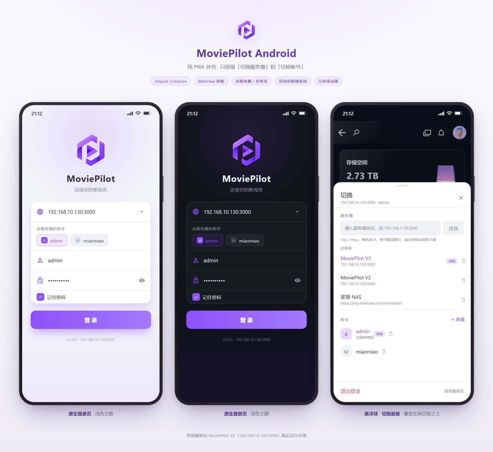
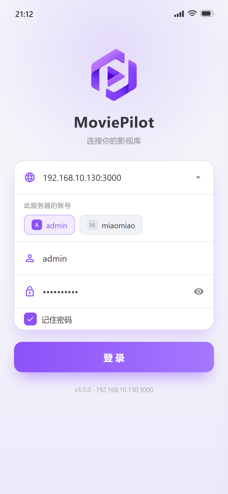
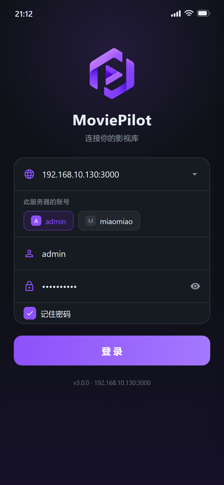
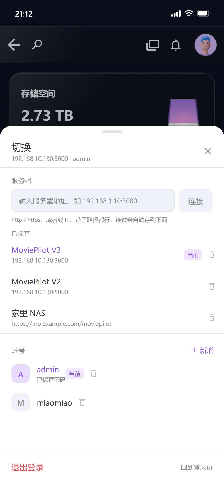
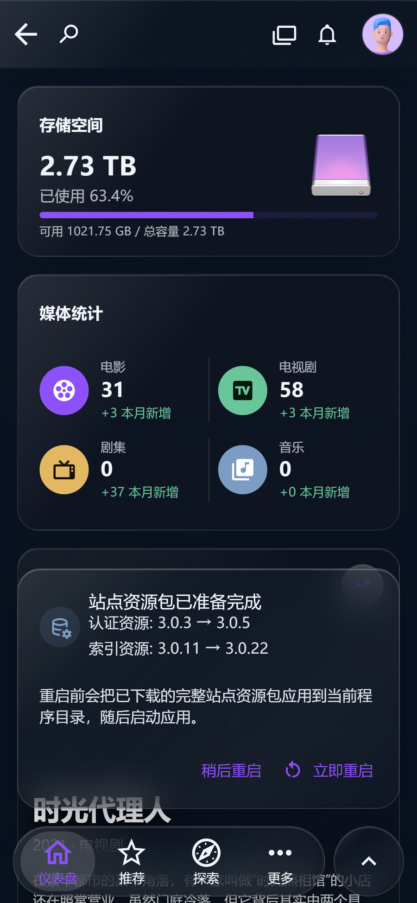
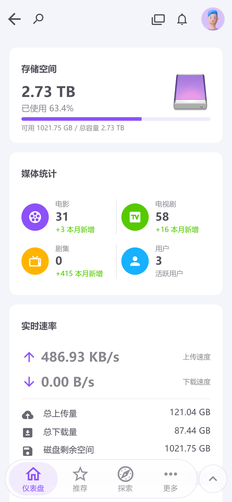

<p align="center">
  
</p>

<h1 align="center">MoviePilot Android</h1>

<p align="center">
  <b>纯 PWA 外壳</b> · 只保留「切换服务器」和「切换账号」<br>
  <sub>界面与功能全部由 MoviePilot 服务端网页版提供，客户端不再实现任何业务页面</sub>
</p>

<p align="center">
  
  
  
  
</p>

<br>

<p align="center">
  
</p>

<br>

## 界面预览

<table>
  <tr>
    <td align="center" width="33%">
      <br>
      <sub><b>原生登录页</b> · 浅色主题</sub>
    </td>
    <td align="center" width="33%">
      <br>
      <sub><b>原生登录页</b> · 深色主题</sub>
    </td>
    <td align="center" width="33%">
      <br>
      <sub><b>悬浮球 · 切换面板</b> · 覆盖在网页版之上</sub>
    </td>
  </tr>
</table>

服务器地址完全由用户输入，同一台服务器可以保存多个账号：

| MoviePilot V3 · 网页版（真实运行截图） | MoviePilot V2 · 网页版（真实运行截图） |
|:--:|:--:|
|  |  |
| `192.168.10.130:3000` · 深色玻璃主题 | `192.168.10.130:5000` · 浅色主题 |

> 想看可交互的界面演示：直接用浏览器打开 [`docs/preview.html`](docs/preview.html)。
> 登录页与切换面板是按 Compose 参数 1:1 还原的静态预览，网页版部分为真实运行截图。

<br>

## 功能特性

这是一个 **PWA 外壳**：界面与功能全部由 MoviePilot 服务端网页版提供，App 只负责连接与切换。

- 原生登录（服务器地址 + 账号密码）
- **服务器地址完全由用户输入**：没有内置/预置地址，IP、域名、http/https、反向代理子路径都支持，登录过自动存为历史
- 未写协议时自动尝试 http / https（内网优先 http，公网域名优先 https）
- 多服务器保存与切换（兼容 V2 / V3 服务端）
- 同一服务器多账号保存与切换
- 登录后全屏加载网页版，自动把 `auth` + `user` 两个 Pinia store 注入网页登录态，由网页版自己决定进主页
- 原生界面跟随系统浅色 / 深色主题，配色与网页版 V3 一致
- WebView 使用 iOS Safari UA，移动端布局与设计稿一致
- 内容永远避让状态栏/导航栏；预留区域用网页顶栏色填充，状态栏图标明暗跟随网页实际配色
- 可拖动悬浮球：切换服务器 / 切换账号 / 退出登录
- 自签名 HTTPS 证书可手动确认后继续
- 无转场动画，启动直接进入网页版

> 原生不再实现仪表盘、订阅、下载、插件、设置等页面——服务器前端升级后客户端无需跟着适配。

## 技术栈

- **语言**: Kotlin
- **UI框架**: Jetpack Compose
- **架构**: MVVM
- **依赖注入**: Hilt
- **网络**: Retrofit + OkHttp（仅登录与 token 校验）
- **网页容器**: Android WebView
- **存储**: DataStore + Android Keystore（密码 AES-GCM 加密）

## 项目结构

```
app/src/main/java/com/moviepilot/app/
├── data/
│   ├── local/           # 服务器/账号/会话存储
│   ├── model/           # ServerProfile / AccountProfile / LoginResponse
│   ├── network/         # ApiClient、登录接口、本地图标加速
│   └── repository/      # AuthRepository
├── di/                  # 依赖注入
├── ui/
│   ├── AppRoot.kt       # 登录页 / 网页版切换
│   ├── screens/         # LoginScreen、PwaScreen、SwitchPanel
│   ├── theme/           # 深色主题
│   └── viewmodel/       # AuthViewModel
├── MainActivity.kt
└── MoviePilotApp.kt
docs/
├── preview.html         # 可交互界面预览页
├── assets/              # 预览页用图标
└── screenshots/         # README 截图
```

## 构建要求

- Android Studio Hedgehog (2023.1.1) 或更高版本
- JDK 17 或更高版本
- Android SDK API 35
- Gradle 8.9

## 构建步骤

### 1. 配置 Android SDK 路径

复制 `local.properties.template` 为 `local.properties`，并修改为你的实际 SDK 路径：

```properties
sdk.dir=C\:\\Users\\YourUsername\\AppData\\Local\\Android\\Sdk
```

### 2. 使用 Android Studio 构建

1. 用 Android Studio 打开项目文件夹
2. 等待 Gradle 同步完成
3. 点击 "Run" 按钮或使用快捷键 `Shift+F10`

### 3. 使用命令行构建

```bash
# Debug 版本
./gradlew assembleDebug

# Release 版本（需要配置签名）
./gradlew assembleRelease
```

构建成功后，APK 文件位于：
- Debug: `app/build/outputs/apk/debug/app-debug.apk`
- Release: `app/build/outputs/apk/release/app-release.apk`

## 首次使用

1. **安装 APK** 到你的 Android 设备
2. **启动应用**，在登录界面输入你的 MoviePilot 服务器地址（例如 `192.168.1.10:3000`、`https://mp.example.com`、`https://example.com/moviepilot`）
3. **输入账号密码**，点击登录
4. 登录成功的地址会自动保存为历史记录，下次可一键切回；也可以随时在悬浮球里输入新地址

## 注意事项

1. **网络权限**: 应用需要网络访问权限，已在 AndroidManifest.xml 中声明
2. **HTTP明文传输**: 当前服务器使用 HTTP，已在 manifest 中启用 `usesCleartextTraffic="true"`
3. **最低Android版本**: Android 8.0 (API 26)

## 许可证

本项目基于 MIT 许可证开源。
